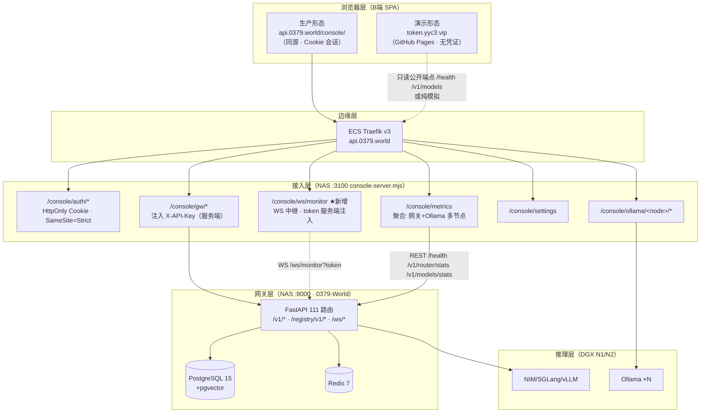

# YYC³ 双端完全联通方案 — B端 Console × 0379-World 后端

> 版本: v1.0 · 生成日期: 2026-10-15
> 范围: `/Users/yanyu/YYC-Cube/YYC3-AI-API-Token-Console`（B端可视化面板）× `/Users/yanyu/YYC-Cube/YYC3-0379-World`（FastAPI 模型网关后端）
> 方法: 双仓库实码盘点（路由表 / 数据 hooks / 网络调用全量枚举 / 后端 111 路由 + 3 WS / 部署拓扑），交叉比对既有冻结契约 `docs/YYC3-AI-Family-Token-Console-模型网关/开发推进/01-*.md`（52 端点快照 + CI 哈希门禁）
> 配套: 路由全景见 [YYC3-全局导航功能架构可视化.md](YYC3-全局导航功能架构可视化.md)

---

## 0. 结论摘要（TL;DR）

> **硬约束（用户裁定，不可删减）**
> ① **监控面板多端设备真实链接、真实呈现**：`/` 页节点矩阵与全部 KPI 必须来自真实设备（网关上游池 / Ollama 多节点 / NAS 网关自检 / A2A Agent 容器），现有 9 个 GPU 假节点档案退役；任何指标无真实来源时显示「无数据」态，**禁止以模拟数值冒充实测**。
> ② **AI Family 时钟页多 Agent 为必备功能**：钟盘接 `/v1/a2a/agents` 真实心跳注册表（90s 超时=离线），八位家人=八个真实 Agent 容器在线态，从 P2 增值项升级为 **P0 硬约束任务**。
> ③ **后端操作项全量覆盖（0379-World 所有操作项）**：后端 111 路由中的每一个「人类可操作项」必须在 B端页面**可视可操作**，或**封装为定制技能**（CommandPalette ⌘K 技能注册表 + 操作中心工具广场，经 `/console/gw` 执行）；仅机器端点（worker 心跳/认领、Prometheus 抓取、节点心跳上报）豁免并登记理由。覆盖矩阵见 §11。

1. **双端不需要推倒重来，主链路资产已存在**：前端已有 5 条真实链路直连网关（`/models` 管理面、`/gateway-keys` 虚拟密钥 CRUD、FamilyChat 对话、`/connection-test` 四类探测、console 登录），后端 111 路由中约 **30 个端点可直接喂饱 B端看盘主页面**。
2. **联通的正确通道是「接入层代理」，不是浏览器直连**：生产架构 = 浏览器 → console-server（`api.0379.world/console`，HttpOnly Cookie 会话 + `GW_ADMIN_KEY` 服务端注入）→ 网关。该模式已落地（`/console/gw/*`），本方案将其推广到全部数据面。
3. **两大硬阻塞及其解法**：
   - **WS 协议不匹配**：后端 `/ws/monitor` 推 `{event:"metrics",...}`（需 `?token=` API Key），前端 `useWebSocketData` 消费 7 种自有消息类型 → 新增「网关 WS 适配层」（console-server WS 中继 + 前端 adapter），密钥永不进浏览器。
   - **第三方 Cookie 禁令**：console 会话 Cookie 为 `SameSite=Strict`（`deploy/console-server.mjs:19`），GitHub Pages（`token.yyc3.vip`）跨站调用必然无凭证 → **生产联通形态锁定 console 同源部署**（`api.0379.world/console/` 下发 SPA 构建），Pages 形态定位为公开演示（只读公开端点 + 模拟底座）。
4. **无关功能清理可立即执行**：9 个纯 mock 页面/模块归档或收敛（`/loop`、`/users`、`/audit` 硬编码数据、`useServiceLoop`、IDE mock 残留等），三套冗余网络配置收敛为一源，预计可减约 15–20% 死代码维护面。
5. **实施分三阶段**：P0 零后端改动打通 12 个页面（console-server 扩 2 个端点 + 前端适配）；P1 后端补齐 4 个数据端点（对齐其后端自身 Backlog BL-01~08）；P2 契约治理与 E2E。

---

## 1. 双端现状盘点

### 1.1 B端（Token Console）数据源三档现状

前端已内建三档数据链（`useWebSocketData.ts`）：**WS 实时 → REST 轮询 → 本地模拟**。当前各页面实际档位：

| 档位 | 页面/模块 | 说明 |
| --- | --- | --- |
| **真实（已通）** | `/models` 网关实况（`/healthz`·`/v1/router/stats`·`/v1/models`）、`/gateway-keys`（`/v1/admin/virtual-keys` CRUD+usage）、上游池推送（`/v1/admin/upstreams`）、FamilyChat（`/chat/completions`）、`/connection-test` 四类探测、console 形态登录与设置下发、`/patrol` 实况档（`/console/metrics` 可达时）、FamilyDrama 五服务探针 | 直连或经 `/console/gw` 代理 |
| **半真实（可达即真）** | `/`（WS 断时模拟；REST 档取 `/console/metrics` 聚合 Ollama `/api/ps`）、`/ai` 内嵌 SDK 对话（有 apiKey 才真）、`/database`（`enableBackend=false` 默认锁 mock） | 有接缝、默认走 mock |
| **纯 mock（无网络语义）** | `/operations`、`/loop`、`/reports`、`/audit`、`/users`、`/ai-diagnosis`、`/ai` 建议 Tab、AIAssistant 浮窗、`/files` 虚拟文件树、AI Family 静态子页（home/share/learn/music/growth/phone/fun/activities） | 见 §7 清理清单 |

### 1.2 后端（0379-World）面向 B端的能力面

后端为生产运行中的 FastAPI 统一模型网关 v2.3.0（`api.0379.world`，NAS :8000，PG15+pgvector+Redis 全套）。与本 Console 看盘直接相关的端点分组：

| 能力组 | 端点 | 可喂饱的 B端页面 |
| --- | --- | --- |
| 健康与全局指标 | `GET /health`（全量：Ollama/Redis/PG+CPU/内存/磁盘+网关指标）、`/healthz`、`/metrics`(Prometheus) | `/` KPI 卡、`/patrol` 巡查 |
| 路由器/节点池 | `GET /v1/router/stats`（上游池快照+EWMA 权重）、`/v1/router/health`、`POST /v1/admin/upstreams/probe` | `/` 节点矩阵、`/models` 实况、`/connection-test` |
| 模型统计 | `GET /v1/models/stats`（usage/延迟 EWMA/错误率/tokens）、`/v1/models/errors`、`/v1/models/summary`、`/v1/models` | `/` 模型负载分布/性能雷达、`/reports` |
| 虚拟密钥与账单 | `/v1/admin/virtual-keys` CRUD + `/{id}/usage?days=` + `/v1/admin/usage/summary?group_by=` | `/gateway-keys`（已接）、`/reports` |
| 模型注册中心 | `/registry/v1/models`（TTL 健康）、`/events`、`/audit`、heartbeat/drain/canary/aliases | `/audit`、`/models`、告警事件源 |
| 上游池管理 | `/v1/admin/upstreams` GET/POST/PUT/DELETE | `/models`（已接推送） |
| 实时通道 | `WS /ws/monitor`（5s 指标推送）、`WS /ws/chat`、SSE `/v1/chat/completions` | `/` 实时趋势、AIAssistant |
| AI 能力 | chat SSE、`/v1/agent/execute`（九步）、`/v1/agent/tasks` 异步、A2A 编排 | `/ai`、`/ai-diagnosis`、AIAssistant |
| MCP 工具 | `POST /v1/mcp/database/query`、`GET /v1/mcp/database/tables`、`POST /v1/mcp/filesystem/read|list`、docker/logs 等 16 条 | `/database`、`/files`（只读）、`/operations` 真实化 |
| 知识库 RAG | `/v1/knowledge-bases`、`/v1/documents`、`/v1/rag/*` | 暂无对应页面（保留域） |

**后端已知缺口**（其后端自家文档 Backlog 已承认）：无 `/v1/logs` 请求级日志查询、无 `/v1/usage/timeline` 时序端点、`/v1/models/summary` 的 `cost_usd` 硬编码 0.0、UsageLog 缺 latency/status 字段、无用户账号体系、告警只走 Prometheus/Alertmanager 不经 HTTP 暴露。

### 1.3 既有契约资产（不重复造轮子）

- **冻结契约**: `模型网关/开发推进/01-*.md` — 52 端点总表 + 字段级 Schema + SSE 协议，CI 以 `openapi.json` 哈希守门，**本方案的端点引用一律以该契约为准**。
- **接入层**: `deploy/console-server.mjs`（:3100，Traefik `api.0379.world/console`）已实现五组能力：`/console/auth/*`（HttpOnly Cookie + 限流）、`/console/ollama/<node>/*` 多节点反代、`/console/metrics` 指标聚合、`/console/settings` 下发、`/console/gw/*` 网关代理（注入 `X-API-Key`，未配置时 503）。
- **前端接缝**: `lib/api-config.ts`（8 端点 + `GATEWAY_DEFAULTS`，网关默认 `https://api.0379.world/console/gw/v1`）、`lib/env-config.ts`（31 变量）、`MockSupabaseClient`（Supabase 形状，console 形态已切真实）、`useWebSocketData` 消息协议 + `pushLocalAlert` 汇聚口。

---

## 2. 目标联通架构

### 2.1 三层拓扑



### 2.2 部署形态决策（决定性约束）

| 形态 | 地址 | 凭证 | 定位 |
| --- | --- | --- | --- |
| **Console 同源（主）** | `https://api.0379.world/console/` | HttpOnly Cookie（SameSite=Strict 同源必带） | **唯一完整联通形态**：全部数据面 + 管理面。构建产物以 `VITE_BASE=/console/` 下发（`routes.ts` basename 已支持） |
| GitHub Pages（辅） | `https://token.yyc3.vip` | 无（跨站 Cookie 被 SameSite=Strict + 浏览器第三方 Cookie 禁令双重阻断） | 公开演示/招募页：仅消费免认证端点（`/health`、`/v1/models`、`/v1/ping`），其余走既有模拟底座 |

> 不采用「Pages + CORS + 跨站 Cookie」方案：`ALLOWED_ORIGINS` 即便放行 `token.yyc3.vip`，Chrome/Safari 的第三方 Cookie 屏蔽会使凭证永不随请求发送，且管理密钥进浏览器违反本仓库「零密钥暴露」红线。CORS 面因此保持最小（仅网关自域）。

---

## 3. 核心设计决策

| # | 决策 | 依据 |
| --- | --- | --- |
| **D1** | **一切网关调用经 `/console/gw/*` 代理**，浏览器永持零密钥（`gatewayAdminKey` 保持占位值 `"proxy"`） | 已验证模式（`GatewayKeysPanel`）；红线「零硬编码密钥」；console-server 未认证 401 |
| **D2** | **生产联通 = console 同源部署**，Pages 形态降级为演示 | SameSite=Strict（console-server.mjs:19）+ 第三方 Cookie 禁令，见 §2.2 |
| **D3** | **WS 走中继不走直连**：console-server 新增 `/console/ws/monitor`，服务端持 token 连网关 `/ws/monitor`，向浏览器转发（复用会话 Cookie 鉴权） | 网关 WS 要求 `?token=API_KEY`（websocket.py:184），密钥不可进 URL/浏览器 |
| **D4** | **前端新增「网关数据适配层」** `lib/gateway-adapter.ts`：把 `/ws/monitor` 的 `{event:"metrics"}` 与 REST 端点形状翻译为 `useWebSocketData` 既有 7 种内部消息，页面组件零改动 | 契约冻结不可前端私改；页面消费链已稳定（4 组件消费 WebSocketContext） |
| **D5** | **网络配置三源收敛为一源**：`api-config.ts`（`yyc3_api_endpoints`）为唯一事实源，`env-config.ts` 的 `API_BASE_URL`/`WS_ENDPOINT` 与 `network_config` 的 `serverAddress` 改为其派生视图 | 当前三处互不打通（env-config 默认 `192.168.3.1:3118`、api-config 默认 `localhost:3113`、network_config 生成 wsUrl），设置页改一处另两处不动的 bug 面 |
| **D6** | **降级链保留且语义升级**：WS 中继 → REST(`/console/metrics`) → 模拟，三档 `connectionState = "live" | "rest" | "simulated"` 在两形态下都有定义（Pages 恒模拟/只读公开档） | P0 落地的既有架构（2026-10-05 轮），扩展而非替换 |

---

## 4. 页面级对接矩阵（25 路由全表）

通道代号： **GW** = `/console/gw/v1/*`（代理注入密钥） · **CS** = console-server 自有端点 · **LOCAL** = 本地持久化 · **MOCK** = 模拟 · **PUB** = 免认证公开端点。阶段见 §8。

| 路由 | 现状 | 目标数据源（端点） | 通道 | 阶段 |
| --- | --- | --- | --- | --- |
| `/` 数据监控 | WS 默认不可达→模拟；REST 档 `/console/metrics`（仅 Ollama 维度）；节点档案为 9 个 GPU 假节点种子（`lib/nodes.ts`） | ① WS: `/console/ws/monitor` ← 网关 `/ws/monitor`（QPS/延迟/吞吐/节点状态）② REST 增强: `/console/metrics` 聚合 `/health`+`/v1/router/stats`+`/v1/models/stats` ③ KPI: `/health`（CPU/内存/磁盘实测，替换写死 12.8TB）④ **节点矩阵=真实多端设备清单**（§5.4 四源聚合，假节点种子退役） | CS+GW | **P0**（硬约束①） |
| `/follow-up` 一键跟进 | mock 种子任务 | 告警事件源接真实（`/registry/v1/events` + 本地规则引擎评估 WS 实况）；任务流转保持 LOCAL | GW+LOCAL | P1 |
| `/patrol` 巡查 | 实况档已有（fetchRealChecks） | 巡查项逐项映射：`/health`（DB/Redis/Ollama 探测）+ `/v1/router/health`（节点）+ `/v1/models/errors` | CS+GW | **P0**（增强映射） |
| `/alerts` 告警规则 ✅R5 | 规则 LOCAL + 服务端 /v1/admin/alerts 源 | 规则 LOCAL（评估引擎本地跑）；事件源 = WS 实况阈值评估 + `/registry/v1/events`；P2 评估后端新增 `/v1/admin/alerts` | GW+LOCAL | P1 |
| `/operations` 操作中心 | 全 mock | 真实操作映射 MCP 工具（`/v1/mcp/docker/containers`、`/v1/mcp/docker/logs`、`POST /v1/admin/upstreams/probe`）；纯展示动作归档（见 §7） | GW | P1 |
| `/files` 文件管理 | 虚拟文件树 LOCAL | 改造为**只读**网关文件视图：`/v1/mcp/filesystem/list|read`（经 GW 代理，服务端白名单路径） | GW | P1（或归档） |
| `/database` 数据库管理 | `enableBackend=false` 锁 mock | 开启后端档：`dbBase` 指向 GW 适配（`/v1/mcp/database/tables`、`POST /v1/mcp/database/query` 只读）；本地 mock 保留为演示档 | GW | P1 |
| `/connection-test` 连接测试 | 真实探测（已通） | 增加网关中继探测项：`/console/gw/v1/ping`、`/console/ws/monitor` 握手 | CS | **P0** |
| `/loop` 服务闭环 | 六阶段全 mock | **归档**（§7）；其「闭环」语义由 `/follow-up` + `/registry/v1/events` 承接 | — | 清理批 |
| `/reports` 报表导出 | 随机数生成 | 真实数据: `/v1/admin/usage/summary?days=`（账单分组）+ `/v1/models/stats`（延迟/错误率）+ `/health` 时序采样（本地累积时序库）；导出引擎不变 | GW | **P0** |
| `/ai` AI 辅助决策 | 建议 Tab mock；SDK 对话真 | 建议 Tab: 真实指标 → `POST /console/gw/v1/chat/completions`（系统提示词=决策分析，输入=`/console/metrics` 快照）；SDK 对话面板保持 | GW | P1 |
| `/models` 模型矩阵 | **已通**（实况+上游推送） | 补: `/v1/models/stats` 指标列、`/registry/v1/models` 注册中心健康列 | GW | **P0**（增强） |
| `/ai-diagnosis` AI 诊断 | 随机异常模式 | 输入真实: `/v1/models/errors` + `/ws/monitor` 节点状态 → 诊断推理走 chat SSE（诊断提示词）；历史 LOCAL | GW | P1 |
| `/ai-family` 钟盘 + 静态子页 | 钟盘静态演示（无任何 fetch/store） | **钟盘必接真实多 Agent 心跳**（硬约束②）: `GET /v1/a2a/agents`（90s 心跳注册表，8 角色 Agent + orchestrator 已容器化于 N2 :25600-07/:25700）→ 八位家人在线/离线/能力标签实况；orchestrator 作中心枢纽呈现（家人↔agent_id 映射表实施时按注册表实测确认）。静态子页不强制接后端 | GW | **P0**（硬约束②） |
| `/ai-family-sub/chat` | **已通**（网关对话+降级） | 保持；人格 prompt 与成员模型映射已在位 | GW | — |
| `/ai-family-sub/drama` | 五服务真实探针 | 保持 | PUB/CS | — |
| `/ai-family-sub/*` 其余 | LOCAL 配置/静态 | 保持（Family 演示域，不属看盘主线，不接后端） | LOCAL | — |
| `/design-system` `/dev-guide` | 静态规范 | 保持（开发者文档域） | — | — |
| `/audit` 操作审计 ✅R5 | ~~硬编码 12 条~~ /v1/logs 实况 | 接 `/registry/v1/audit`（注册中心审计）+ `/v1/a2a` 审计流（Loki 源，后端扩展项 BL-A4）；本地操作日志继续并入 | GW | P1 |
| `/users` 用户管理 | mock 用户 CRUD | **归档**（§7）：console 形态用户=会话角色（admin），无多用户语义 | — | 清理批 |
| `/settings` 系统设置 | LOCAL+console 下发（已通） | 保持；网络分区按 D5 收敛为 api-config 单源 | CS | **P0**（D5） |
| `/security` 安全监控 | 浏览器自检+mock | 保持浏览器自检域 + 增「网关视角」卡片: `/health` 的认证/限流/CORS 状态摘要 | GW | P2 |
| `/pwa` `/env-config` | 浏览器/LOCAL | 保持（按 D5 收敛配置源） | — | **P0**（D5） |
| `/gateway-keys` 网关密钥 | **已通**（vk CRUD+usage） | 保持，为账单主入口 | GW | — |

---

## 5. 协议适配契约

### 5.1 WS 中继与消息映射（D3+D4 核心）

**console-server 新增** `GET /console/ws/monitor`（Upgrade）：

```
浏览器 ──(Cookie 会话鉴权)──> /console/ws/monitor
console-server ──(WS /ws/monitor?token=<GW_ADMIN_KEY 环境变量>)──> 网关
转发方向: 网关 {event:"metrics",data:{...}} 原样透传浏览器；心跳 25s ping/pong
```

**前端 adapter**（`lib/gateway-adapter.ts`，`useWebSocketData` 注入）把网关 metrics 帧翻译为既有内部消息：

| 网关字段（/ws/monitor 5s 帧） | 内部消息 | 消费页面 |
| --- | --- | --- |
| `data.models.{upstream}.load` / 全池聚合 | `qps_update`（liveQPS）+ `throughput_history` 追加 | `/` 趋势图 |
| `data.models.{upstream}.latency_ms` | `latency_update`（liveLatency） | `/` 延迟趋势 |
| `data.models.{upstream}.status`(breaker) + `load` | `node_status`（nodes[] 状态映射 healthy/degraded/down） | `/` 节点矩阵、`/patrol` |
| `data.cache_hit_rate` `active_requests` `total_requests` | `system_stats`（KPI 卡补充） | `/` |
| 阈值评估（adapter 内，规则取 `/alerts` 本地规则库） | `alert`（经 `pushLocalAlert` 同一队列） | `/alerts`、`/follow-up` |
| —（连接建立确认） | `heartbeat_ack` | TopBar 连接状态 |

> **指标真实化铁则（硬约束①）**：网关 WS 帧未覆盖的指标一律真实化——`tokenThroughput` 由 `/v1/models/stats` 的 `total_tokens` 差分计算；`storageUsed` 对接 `/health` 磁盘实测（替换现写死 `"12.8TB"`）；`gpuUtil` 对接 Ollama 节点 `/api/ps` 显存占位（经 `/console/metrics`）。**任何 KPI 无真实来源时渲染「无数据」空态，禁止以模拟数值冒充实测**（模拟底座仅在 `connectionState="simulated"` 断连档存在，且顶栏状态标识必须可见）。BL-A2 timeline 端点落地后差分升级为服务端时序直读。

### 5.2 REST 形状约定（P0 落地即可用）

- `/console/metrics`（增强）: 现有 Ollama `/api/ps` 聚合之外，并列返回 `{ gateway: { health: <GET /health>, router: <GET /v1/router/stats>, models: <GET /v1/models/stats> } }`——前端 `fetchRealChecks` 与 `/` REST 档零破坏升级（新增字段，旧字段保留）。
- 全部管理面调用统一前缀 `getGatewayConfig().gatewayBase`（默认 `https://api.0379.world/console/gw/v1`），禁止组件内拼 `https://api.0379.world/v1` 直连（eslint boundaries 可加规则固化）。

### 5.3 配置收敛目标态（D5）

| 配置项 | 唯一事实源 | 派生关系 |
| --- | --- | --- |
| 网关地址/密钥占位 | `api-config.ts` `GATEWAY_DEFAULTS`（`yyc3_gateway_config`） | 已是事实源，保持 |
| WS 端点 | `api-config.ts` `wsEndpoint`，默认改 `wss://api.0379.world/console/ws/monitor` | `env-config.WS_ENDPOINT` 与 `network_config.serverAddress` UI 改为读写此值（双写消除） |
| metrics/db/fs/cluster 端点 | `api-config.ts` | `/env-config` 网络组与 `/settings` 网络分区渲染同一配置对象 |
| `enableBackend` | 保持 `false` 默认 + console 形态部署时经 `VITE_ENABLE_MOCK=false` 注入开启 | Pages 形态天然 mock |

### 5.4 多端设备清单聚合契约（硬约束①核心）

`/` 页节点矩阵的数据底座从「9 个 GPU 假节点 localStorage 档案」切换为**四源真实设备聚合**，由 `gateway-adapter` 统一归一化为 `nodes[]`（复用既有 `node_status` 消息通道，页面组件零改动）：

| 设备源 | 端点（经 GW/CS 代理） | 归一化字段 | 刷新 |
| --- | --- | --- | --- |
| ① 网关上游推理池（DGX NIM/SGLang/vLLM） | `GET /v1/router/stats`（上游快照+EWMA 权重+熔断态） | id=upstream name · status（healthy/degraded/down=breaker）· load · latency_ms | WS 帧 `data.models.*` 每 5s |
| ② Ollama 多节点（n1/n2） | `/console/metrics`（console-server 聚合各节点 `/api/ps`：运行模型+显存+活性） | id=node name · status · runningModels · gpuUtil（显存占比） | REST 轮询档 |
| ③ NAS 网关本体 | `GET /health`（Ollama/Redis/PG 并发探测 + CPU/内存/磁盘 + 网关指标） | id="nas-gateway" · status · cpu/mem/disk | REST 轮询档 |
| ④ A2A Agent 容器（N2 八角色 + orchestrator） | `GET /v1/a2a/agents`（心跳 ≤90s 视在线） | id=agent_id · status（online/offline）· capabilities | 30s 轮询 |

归一化规则：`lib/nodes.ts` 的 `yyc3_nodes` mock 种子（GPU-A100-01~08/H100-01 假节点）退役为空态 fallback——仅当四源全部不可达时渲染且带「模拟」标识；设备以 `kind: upstream | ollama | gateway | agent` 区分，节点矩阵按 kind 分组为「推理节点 / 本地模型节点 / 网关系 / Agent 容器」四组呈现，即「多端设备真实链接」的落地形态。

---

## 6. 后端待扩展清单（P1，对齐其后端自身 Backlog）

按其后端冻结文档既有 Backlog（BL-01~08）收敛为 4 项新增 + 1 项修复，**全部经 `/console/gw` 代理消费，无需新鉴权面**：

| 编号 | 端点/改动 | 服务的 B端页面 | 对应后端既有 Backlog |
| --- | --- | --- | --- |
| BL-A1 ✅R4 | `GET /v1/logs?since=&model=&status=&limit=`（UsageLog 查询 + 补 latency_ms/status/error_code/request_id 字段） | `/audit` 请求级审计、`/` 实时操作流 | BL-01/06/07 |
| BL-A2 ✅R4 | `GET /v1/usage/timeline?window=1h&step=5m&group_by=model`（时序聚合，供趋势图直读） | `/` 吞吐/延迟趋势、`/reports` 历史报表 | BL-06 |
| BL-A3 ✅R4 | `/v1/models/summary` 的 `cost_usd` 接 `model_prices`/`task_prices` 真实计算（现硬编码 0.0，main.py:738） | `/reports` 成本报表 | BL-02 |
| BL-A4 ✅R4 | `GET /v1/admin/alerts?level=`（把 Prometheus/Alertmanager 告警经网关 HTTP 暴露只读查询；或 `/registry/v1/events` 分级扩写） | `/alerts`、`/follow-up` 服务端事件源 | 新增（评估） |
| BL-A5 | `ALLOWED_ORIGINS` 维持最小集（网关自域）；console 同源形态不依赖 CORS 放行 | — | 配置项确认 |

---

## 7. 无关功能归档/清理清单

> **硬约束保护项（永不进入本清单）**: 监控面板 `/` 全量功能（多端设备真实链接、四源设备清单）与 AI Family 钟盘 `/ai-family`（多 Agent 实况）——两者按用户裁定不可删减；本节清理仅针对「冒充真实的 mock 数据源」与无真实语义的演示页，且替换物（真实链路）先行落地后才可移除。

### 7.1 立即归档（纯 mock、无真实数据语义、与看盘主线无关）

沿用既有归档惯例（原名移入 `docs/archive/` 或源码按 `archive/src-*/` 分目录；导航层走 `routes.ts` 重定向收拢先例）：

| 对象 | 处置 | 理由与收益 |
| --- | --- | --- |
| `/loop` 路由 + `useServiceLoop.ts` + `ServiceLoopPanel` | 归档，路由重定向 `/follow-up` | 六阶段全硬编码 mock；闭环语义已被跟进+事件流覆盖 |
| `/users` 路由 + `UserManagement` + `yyc3_users` store | 归档，路由重定向 `/settings` | mock 用户 CRUD；console 形态用户=会话角色 |
| `useServiceLoop` 的 MOCK_STAGE_RESULTS、`useOperationCenter` 纯展示 Quick Actions | 随页面处置 | — |
| `components/ide/` IDE 页残留（`ide-mock-data.ts` 等，路由已重定向 dev-guide） | 移入 archive | 死代码（knip 基线外残留） |
| `lib/db-queries.ts` 三套 mock 默认表（models/agents/nodes 种子） | 裁剪为最小 fixture | `/database` 转 MCP 后不再需要 |
| `OperationAudit` 硬编码 ALL_AUDIT_LOGS 常量 | P1 接 `/registry/v1/audit` 时删除 | 假数据有误导风险 |
| `useReportExporter` 随机历史生成器 | P0 接真实 usage 后删除 | 同上 |
| `lib/nodes.ts` 9 个 GPU 假节点种子（GPU-A100-01~08 + H100-01） | 退役为四源全不可达时的空态 fallback（带「模拟」标识）；节点清单由 §5.4 真实设备聚合派生 | 硬约束①：多端真实呈现 |
| `stores/dashboard-stores.ts` 中 modelPerf/modelDist/radar/recentOps 种子 | 改由 `/v1/models/stats` 实况派生，仅保留空态 fallback | `/` 页面真实化 |

### 7.2 改造后保留（半真实→真实）

- `/files`：虚拟文件树 → MCP filesystem 只读视图（或若评估无使用场景，降级归档）。
- `/database`：`enableBackend` 通道对齐 MCP database 端点；mock 档降为演示。
- `/operations`：保留「操作模板」LOCAL 域 + 真实动作接 MCP/probe；删除纯展示动作。
- `/ai` 建议 Tab、`/ai-diagnosis`、AIAssistant 浮窗：生成器退役，推理链走 `/console/gw/v1/chat/completions`（SSE 契约按冻结文档 §1.4 严格实现）。
- `MockSupabaseClient`：保留为 Pages/本地形态降级实现（其文件头 RF-012 迁移指南继续有效），console 形态已走真实。

### 7.3 保留不动（与主线无关但定位明确）

`/design-system`、`/dev-guide`（开发规范域）；`/pwa`、`/env-config`、`/security`（系统管理域，浏览器自检语义自洽）；AI Family 静态子页（Family 演示域；**钟盘本体属硬约束保护项已列 P0**，静态子页不强制接后端）。

---

## 8. 分阶段实施计划

### P0 — 零后端改动联通（前端 + console-server，预计 3 个工作轮）

| # | 任务 | 验收 |
| --- | --- | --- |
| P0-1 ✅R1 | console-server 新增 `/console/ws/monitor` WS 中继（D3; 零依赖手写 RFC 6455 服务端帧） | 单测 16 用例含 RFC 官方向量；Traefik Upgrade 透传待部署侧实测 |
| P0-2 ✅R1 | 前端 `lib/gateway-adapter.ts` + `useWebSocketData` 双协议接线（D4, wsEndpoint 默认改中继地址×5 处）; 指标真实化铁则首批（storageUsed/token 吞吐伪值清除, 无源显「—」, token 真实差分轮询） | 单测 +15 用例（adapter 11 + hook 网关帧 4）; 全量 3035/3035 绿; 详见 [实施日志](YYC3-双端联通实施日志.md) |
| P0-3 ✅R2 | `/console/metrics` 聚合网关三端点（§5.2）+ 节点矩阵四源设备清单接线（§5.4）+ **设备可视化可编辑增减**（DeviceInventoryManager + settings.ollamaNodes desired-state） | 节点矩阵呈现 网关上游池/Ollama 节点/NAS 网关/Agent 容器 四组真实设备; Ollama 节点表增删保存即生效; storageUsed=真实磁盘占用率 |
| P0-4 | `/reports` 接 `/v1/admin/usage/summary` + `/v1/models/stats`；随机生成器删除 | 报表数字与网关 vk 账单一致（抽查明细核对） |
| P0-5 ✅R3 | 配置三源收敛（D5·编辑面第一步: NetworkConfig 保存双写 api-config+env 镜像）+ `/settings`、`/env-config` UI 收口 | 改一处端点全链路热生效；三 key 只剩 `yyc3_api_endpoints`+`yyc3_gateway_config` |
| P0-6 ✅R3 | `/connection-test` 增网关中继探测（runGatewayRelayTest 三步: 代理 ping/指标聚合/A2A; runRealtimeSuite 组合执行器 sibling 承载, 壳层零行增长） | 全链路测试 5 组; 实时链快捷按钮 |
| P0-7 ✅R3 | 清理批: /loop /users 归档（git 历史留档, 路由重定向 /follow-up /settings, 导航/补全/审计清单/组件目录/阶段审核同步）; 全门禁绿 |
| P0-8 ✅R2 | **AI Family 钟盘接真实多 Agent**（硬约束②）: `GET /console/gw/v1/admin/a2a/agents` 30s 轮询，家人↔agent_name 中文名映射，心跳超时 90s=离线 | 钟盘八位家人显示真实在线/离线/未接入态, 头部统计=实况（在线家人/容器数/心跳时刻）; 与 N2 容器实况一致（生产验收: 停容器 → 90s 内转离线） |

### P1 — 后端补齐数据面（0379-World 仓库，对应其 CI 流程）

BL-A1~A4 落地 → `/audit` 请求级审计真实、`/alerts`+`/follow-up` 服务端事件源、`/ai`+`/ai-diagnosis`+AIAssistant 推理链真实、`/files`+`/database`+`/operations` MCP 通道开启。验收：冻结契约文档哈希门禁同步更新（新增端点入 52 端点总表升版）。

### P2 — 治理与增值

契约 E2E（后端 `tests/e2e/` Playwright 已有基建，补 Console 关键路径）；`/security` 增网关视角卡片 ✅R7；Pages 演示形态发布流水线（pages.yml 既有; console 双产物 ✅R7 build:console+console-build.yml）。~~AI Family 钟盘接 A2A 心跳~~ 已按硬约束②前置至 P0-8。

---

## 9. 风险与红线核对

| 风险/红线 | 核对结果 |
| --- | --- |
| 零密钥进浏览器/产物 | ✅ D1 全代理；`gatewayAdminKey` 占位 `"proxy"`；文档与示例不出现可用凭据字面量（凭据只经 `GW_ADMIN_KEY` 等服务端环境变量） |
| 第三方 Cookie 阻断 | ✅ D2 规避（同源 console 形态）；Pages 不承载管理面 |
| WS token 泄露面 | ✅ D3 中继后 token 仅存在于 NAS 进程内存 |
| 契约漂移 | ✅ 后端 CI 已有 openapi 哈希门禁；前端消费统一经 adapter，契约变更只改一处 |
| 降级可用性 | ✅ D6 三档链在两形态均有定义；断网/后端维护时 Pages 与本地形态不受影响 |
| 本仓库红线 5（最小改动） | ✅ 分阶段推进，P0 不触碰后端仓库；清理批独立成轮提交 |
| `pnpm size:check`/knip 基线 | ⚠️ 清理批只减不增，符合「基线只减不增」方向；新增 adapter 纳入基线登记 |

---

## 10. 附录：目标态端点配置表

| 键 | 目标默认值 | 形态 |
| --- | --- | --- |
| `wsEndpoint` | `wss://api.0379.world/console/ws/monitor` | console |
| `metricsBase` | `https://api.0379.world/console/metrics` | console（现默认 `/console/metrics` 相对路径，同源等价） |
| `gatewayBase` | `https://api.0379.world/console/gw/v1`（已是默认） | 双形态 |
| `gatewayAdminKey` | `"proxy"`（服务端覆盖） | 双形态 |
| `enableBackend` | console 构建注入 `false`→开启路径按页灰度（`/database` P1） | 分形态 |
| 服务端 env（console-server） | `GW_ADMIN_KEY`（必填，缺失 `/console/gw/*` 503）、`CONSOLE_AUTH_SECRET`、`CONSOLE_ADMIN_PASSWORD` | NAS/Traefik |
| 服务端 env（网关） | `ALLOWED_ORIGINS` 保持 `https://api.0379.world` | 不放行外域 |

---

## 11. 后端操作项全量覆盖矩阵（硬约束③）

覆盖原则：0379-World 每个操作端点三选一归属——**页面直操**（专属页面控件，可视可操作）/ **技能封装**（CommandPalette ⌘K + `/operations` 工具广场的定制技能卡：参数表单 → 经 `/console/gw` 执行 → 结果内联渲染）/ **豁免**（机器端点，登记理由）。「定制技能」注册表以后端 `GET /v1/mcp/tools` 动态发现 + 前端 `skills` 静态声明双源合并。

| 后端操作族（路由数） | 归属 | B端载体 | 阶段 |
| --- | --- | --- | --- |
| 健康诊断 /health /healthz /v1/ping /v1/versions（4） | 页面直操 | `/` KPI · `/patrol` · `/connection-test` | P0 |
| 缓存观测与操作 /v1/cache/*（4） | 技能封装 ✅R4 | gateway-skills: cache-stats/cache-invalidate + `/operations` 工具广场 + ⌘K | P1 ✅ |
| 路由器 /v1/router/stats\|health + probe（3） | 页面直操 | `/` 节点矩阵 · `/operations`「触发上游验活」按钮 | P0 |
| 模型面 /v1/models*（5） | 页面直操 | `/models`（已接，补 stats/errors 列） | P0 |
| 虚拟密钥+账单+价格 /v1/admin/virtual-keys\|usage\|pricing（9） | 页面直操 | `/gateway-keys`（已接）+ 价格表编辑入设置分区 | P0/P1 |
| 上游池 CRUD /v1/admin/upstreams（4） | 页面直操 | `/models` 上游管理（已接推送，补列表/删除 UI） | P1 |
| Chat/能力代理 chat/embeddings/rerank/ASR/OCR（5） | 技能封装 ✅R6（OCR/ASR multipart 技能落地; chat 已接; embeddings/rerank 留 SDK 面板） | ⌘K 技能 + 工具广场 | P2 ✅ |
| 模型注册中心 /registry/v1/*（19） | 页面直操 | `/models` 注册健康列 + `/audit` 事件/审计 + drain/rollback/canary 技能 | P1 |
| A2A /v1/a2a/*（11） | 页面直操+技能 | `/ai-family` 钟盘（发现/心跳可视化，硬约束②）+ orchestrate 技能 | P0/P1 |
| Agent 编排 /v1/agent/execute\|tasks（3+5 worker） | 页面+豁免 | `/ai` Agent 执行面板（execute/tasks/轮询）；worker claim/heartbeat/result/failure 豁免（机器端点） | P1 |
| 知识库/RAG kb+documents+rag（16） | 页面直操 | 新增「知识库」管理页（KB CRUD/上传/检索测试） | P2 |
| MCP 工具 /v1/mcp/*（16） | 技能封装 ✅R6（tools 发现 + execute 执行技能落地） | ⌘K + `/operations` GatewaySkillPlaza | P2 ✅ |
| 视频任务 /v1/video/tasks（4+4 runner） | 技能封装 | 数字人任务技能（提交/查进度/取结果）；runner 豁免 | P2 |
| 管理看板 /v1/admin/dashboard HTML（1） | 归档 | 被 B端整体取代（保留为降级入口，不入导航） | — |
| 机器端点 /metrics /docs /openapi.json /redoc + registry heartbeat（4） | 豁免 | Prometheus 抓取/API 文档/节点 Agent 上报——非人类操作 | — |

覆盖守门：§11 矩阵在后端契约哈希门禁变更（新增路由）时必须同步评审——新增路由默认「未覆盖即阻断合并」，倒逼归属登记。

---

*本文档为双端联通的规划基线；实施时以两仓库实码为准滚动修订，P0 每轮完成后在 [衔接报告](YYC3-全量落地实施总结与衔接报告.md) §8.2 登记。*
